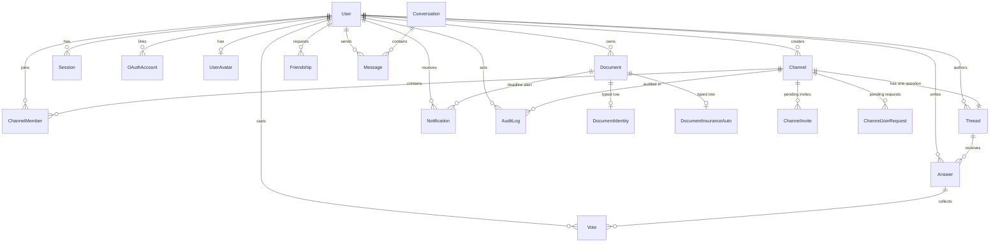

*This project has been created as part of the 42 curriculum by adregis, raisufaj, amkhelif, alehamad*

# MesPapiers

## Description

**MesPapiers** is a paperwork assistant for people navigating French administration —
built for non-French-speaking residents and expatriates, for whom a missed renewal on a
*titre de sejour* or a passport carries the highest stakes and the language barrier sits on
top of the procedural one.

It answers two different kinds of "I don't know what to do here": the kind your own documents
can answer, and the kind only someone who has been through the procedure can.

**Key features**

- **Smart capture.** Photograph or upload a document; an AI vision model extracts its type,
  issuing authority and expiry date into strictly typed JSON — not free text.
- **Typed documents.** Each scan becomes a structured object with real database columns per
  category (an insurance contract has an insurer, a premium and an anniversary date; an
  identity document has a holder name and a number), not a bag of JSON.
- **Deadline dashboard.** Every document shows as *Valid / Expiring Soon / Expired / Action
  Required*, derived at read time so the dashboard can never contradict the alerts.
- **Expiry notifications.** A background worker scans documents every minute. 90 days before
  a hard legal deadline, and again once it has passed, the owner gets a notification in the bell.
- **AI assistant.** Ask questions about your own documents in a streaming chat, including
  "is what I'm paying for this reasonable?" — with any figure labelled explicitly as
  indicative and never as financial advice.
- **Mutual-aid community.** Topic channels (*titre de sejour*, *assurance auto*, CAF) with
  questions, voted answers, direct messaging, friends and per-channel moderation.
- **A hard boundary between the two.** Nothing from a user's private document vault ever
  reaches the community layer.

Full product specification: [`mespapiers_project_vision.md`](mespapiers_project_vision.md).
Execution plan: [`PROJECT_PLAN.md`](PROJECT_PLAN.md).

## Instructions

### Prerequisites

| Tool | Version | Notes |
|---|---|---|
| Docker + Docker Compose, or Podman + `podman compose` | Compose v2 / Podman 4+ | The whole stack runs in containers: nothing else is needed to run it. |
| Node.js | 22 LTS | Only needed for development outside Docker or running tests. |
| npm | 10+ | Ships with Node 22. One lockfile, at the repository root. |
| `mkcert` | latest | Optional — issues a locally-trusted TLS certificate for a green padlock. Without it, the entrypoint generates a self-signed cert automatically. |

### Running the project

From a fresh clone:

```bash
git clone https://github.com/rasiolisufaj/ft_transcendence.git
cd ft_transcendence
cp .env.example .env            # runs as is; see "Configuration" below for the optional keys
docker compose up -d --build    # 6 services: nginx, web, realtime, worker, db, mailpit
docker compose logs -f web      # wait for "Ready", then Ctrl-C
```

The first start builds the image (a few minutes) and applies the database migrations.

**Load the seed data** once `web` is ready:

```bash
docker compose exec web npm run db:seed    # empties every table, then loads the test data
```

Open **https://localhost:8443** and accept the self-signed certificate warning. Log in as
`rasiol@mespapiers.test` (admin), `amir@mespapiers.test`, `adrien@mespapiers.test`,
`alexandre@mespapiers.test`, etc. — all with the password `motdepasse123`. The first visit to
each page is slow: the app runs in development mode and compiles each page on demand.

To stop: `docker compose down` (keeps the data). To start over with an empty database:
`docker compose down -v`, then run the steps above again from `docker compose up`.

**Configuration (`.env`).** Every key has a working default. The optional ones:

- `ANTHROPIC_API_KEY`: enables document extraction and the AI assistant. Left empty, uploads
  still work and documents stay *pending*.
- `POSTGRES_PASSWORD` (and the same value inside `DATABASE_URL`), `WS_TICKET_SECRET`,
  `REALTIME_PUBLISH_SECRET`: on a shared machine, replace `change_me_locally` with random values
  (`openssl rand -hex 32`) **before the first start** — the database keeps the password it was
  created with.
- `GOOGLE_CLIENT_ID`, `GOOGLE_CLIENT_SECRET`: Google sign-in. The OAuth client's redirect URI
  must be `https://localhost:8443/api/auth/google/callback` (`APP_URL` + `/api/auth/google/callback`).

After editing `.env`, run `docker compose up -d` to apply it.

**Podman (e.g. Fedora).** Use `podman compose` wherever this section says `docker compose`.
Once per user account, before the first build:

```bash
mkdir -p ~/.config/containers
# SELinux: let the containers read the bind-mounted source folders
printf '[containers]\nlabel = false\n' > ~/.config/containers/containers.conf
# Resolve the short image names (node, nginx, postgres, mailpit) on Docker Hub
printf 'unqualified-search-registries = ["docker.io"]\n' > ~/.config/containers/registries.conf
```

These two commands overwrite those files: merge by hand if you already have them. If
`podman compose` reports no compose provider, install one with
`python3 -m pip install --user podman-compose`.

**Optional — `https://mespapiers.local:8443`:** add `127.0.0.1  mespapiers.local` to `/etc/hosts`
(needs sudo).

**Optional — for a green padlock:**

```bash
mkcert -install
mkcert mespapiers.local localhost
# Copy the generated .pem files into the nginx-certs Docker volume
```

### Services

| Service | URL | Purpose |
|---|---|---|
| App | https://localhost:8443 | The main application (http://localhost:8080 redirects to it) |
| Mailpit | http://localhost:8025 | Catches all emails (GDPR export, account deletion) |
| PostgreSQL | localhost:5432 | Direct DB access for dev tools |

### Local development without Docker

```bash
npm install
npm run db:generate    # required after install (Prisma client is git-ignored)
npm run dev            # http://localhost:3000
npm run build
npm run typecheck      # run `npm run build` first (see note below)
npm run lint
npm test               # requires the db service to be running for DB tests
```

> **CI ordering note.** Next 16 generates route types (`LayoutProps`, `PageProps`) into
> `.next/types` during `next build`. Running `tsc --noEmit` on a clean checkout therefore
> fails before a build has happened. In CI, `next build` must come **before** the typecheck
> step.

## Team Information

| Member | 42 login | Role(s) | Responsibilities |
|---|---|---|---|
| Adrien | adregis | Product Owner, Developer | Product vision and backlog, prioritisation, validation of completed work. Infrastructure (Docker, nginx), AI extraction and the streaming assistant, 2FA, i18n. |
| Rasiol | raisufaj | Project Manager, Developer | Project plan, progress and risk tracking, meetings and team communication. Authentication, security, permissions, profile, expiry notifications. |
| Alexandre | alehamad | Developer | Real-time WebSocket server, messaging, notifications, friends, i18n catalogues, UI shell. |
| Amir | amkhelif | Technical Lead, Developer | Technical architecture and stack decisions, code review and best practices. Database, community channels, threads, GDPR, seed data. |

## Project Management

- **Work organisation:** one owner per directory, tasks broken down in `PROJECT_PLAN.md` section 7,
  each sized for roughly one developer-day with an explicit acceptance check.
- **Ceremonies:** daily 15-minute standup, Monday planning, Wednesday risk check,
  **Friday integration** (a milestone gate, not a status update).
- **Tools:** GitHub Pull Requests for code review and task tracking, `handoff/WORKLOG.md` for
  progress between sessions.
- **Communication:** Discord for daily communication, in-person meetings at 42.
- **Code review:** no direct pushes to `main`; every change goes through a pull request with
  at least one approving review.

## Technical Stack

| Layer | Choice | Why |
|---|---|---|
| Language | TypeScript everywhere | One language across the web app, the WebSocket process and the worker process; types shared by plain import. |
| Frontend | Next.js 16 (App Router, React 19) | Server Components and Server Actions put UI and HTTP backend in one codebase, which is what the "framework for frontend and backend" major asks for. |
| Styling | Tailwind CSS 4 | Utility-first, zero-runtime CSS framework. |
| Backend | Next.js Server Actions + Route Handlers, plus a dedicated Node `ws` process | Next.js has no supported WebSocket server API, so long-lived connections live in a plain Node process. |
| Database | PostgreSQL 17 | Relational data with real constraints. Uniqueness and transactions — not application code — are what make concurrent actions safe. |
| ORM | Prisma 6 | Type-safe queries and versioned migrations; the generated types are shared by all three processes. |
| Real-time bus | Internal HTTP `/publish` on the `ws` process | Fire-and-forget: `fetch` with a timeout, so posting to a channel still succeeds when the realtime process is down. |
| AI | Anthropic `claude-opus-5` via `@anthropic-ai/sdk` | Vision extraction into strict JSON, and the streaming assistant. |
| i18n | `next-intl` v4 | FR / EN / ES, locale-prefixed routing (`/fr`, `/en`, `/es`). |
| Auth | Hand-rolled (Argon2id, SHA-256 sessions, PKCE OAuth, TOTP) | Following The Copenhagen Book and the Auth Book — no auth library dependency. |
| Infrastructure | Docker Compose + NGINX | One image, three processes (`web`, `realtime`, `worker`); NGINX terminates TLS so every browser-facing request is HTTPS. |

## Database Schema

PostgreSQL 17, accessed through Prisma 6 with the `prisma-client` generator
(output: `src/generated/prisma/`). The whole schema lives in [`prisma/schema.prisma`](prisma/schema.prisma)
and is applied by migrations under `prisma/migrations/`.
Every foreign key is declared with a real `@relation`, timestamps are stored in UTC and
`updatedAt` is set by Prisma on each write.

### Tables (grouped)

**Identity and access**

| Table | Key fields | Purpose |
|---|---|---|
| `User` | `id (cuid)`, `email` unique, `displayName`, `passwordHash?`, `globalRole (USER/ADMIN)`, `locale`, `totpEnabled`, `totpSecret?`, `reputation` | A site account. `passwordHash` is Argon2id. `totpSecret` stores the TOTP seed for 2FA. |
| `Session` | `id (sha256 of token)`, `userId`, `expiresAt`, `twoFactorVerified` | A browser session. Only the hash of the token lives in the DB; the raw token is in the cookie. |
| `OAuthAccount` | `(provider, providerUserId)` unique, `userId` | Links a user to an external identity (Google). |
| `AuditLog` | `actorUserId?`, `action`, `targetType`, `targetId`, `channelId?` (FK, `SetNull`) | One row per privileged action. Rows survive the deletion of their actor and channel. |
| `UserAvatar` | `userId` unique (FK Cascade), `data (bytes)`, `mimeType` | Profile photo, one per user. Separate table so `validateSessionToken` doesn't load bytes. |

**Document vault — class-table inheritance**

The document vault uses class-table inheritance (one base row + one typed row per category).
The base `Document` holds everything shared across categories; a typed table (`DocumentIdentity`,
`DocumentInsuranceAuto`) adds the fields specific to its category.

Why class-table inheritance rather than one `jsonb` blob or one wide table:

- Each typed field is a real column with a real type and a `NOT NULL` where the field is
  mandatory, so an invalid document cannot land in the DB.
- Adding a new category is one Prisma enum value + one new typed table, with no change to
  rows of other categories.
- Common queries (dashboard, deadline scan) read the base table only; typed queries join one
  typed table at a time.

| Table | Key fields | Purpose |
|---|---|---|
| `Document` | `id`, `ownerId` (FK Cascade), `fileName`, `fileType`, `fileSize`, `fileData (bytes)`, `fileHash`, `category (enum)`, `extractionStatus (enum)`, `targetDate?`, `deadlineType?`, `@@unique([ownerId, fileHash])` | The shared base row. The unique index blocks the same file content from being uploaded twice by the same user. |
| `DocumentIdentity` | `documentId` unique (FK Cascade), `fullName`, `birthDate`, `documentNumber`, `expiryDate` | Fields read from an identity document. |
| `DocumentInsuranceAuto` | `documentId` unique (FK Cascade), `provider`, `policyNumber`, `vehiclePlate`, `expiryDate` | Fields read from a car-insurance document. |

**Community**

| Table | Key fields | Purpose |
|---|---|---|
| `Channel` | `id`, `title (VarChar 100)` unique insensitive, `description? (VarChar 250)`, `isPrivate`, `isClosed`, `createdBy?` (FK `SetNull`) | A topic. Title uniqueness is enforced by a `LOWER(title)` unique index. |
| `ChannelMember` | `(channelId, userId)` PK, `role (MEMBER/MODERATOR)`, `joinedAt` | Membership + per-channel role. |
| `ChannelInvite` | `(channelId, userId)` PK | An invite waiting to be accepted. |
| `ChannelJoinRequest` | `(channelId, userId)` PK | A request to join a private channel. |
| `Thread` | `id`, `channelId` unique (FK Cascade), `title (VarChar 150)`, `content (VarChar 300)`, `userId?` (FK `SetNull`) | The main question of a channel. The `@unique` on `channelId` enforces one thread per channel. |
| `Answer` | `id`, `threadId` (FK Cascade), `userId?` (FK `SetNull`), `content (VarChar 300)` | A reply inside a thread. |
| `Vote` | `(answerId, userId)` PK, `value Int` with `CHECK (value IN (-1, 1))` | A vote. The PK prevents double votes; the CHECK prevents junk values at the SQL layer, not just in app code. |
| `Friendship` | `(requesterId, receiverId)` unique, `status (PENDING/ACCEPTED/BLOCKED)` | A friend link. |
| `Conversation` | `(participant1Id, participant2Id)` unique | A private 1-to-1 chat. |
| `Message` | `id`, `conversationId` (FK Cascade), `senderId` (FK Cascade), `content Text` | A message in a conversation. |
| `Notification` | `id`, `recipientId` (FK Cascade), `type (enum)`, `documentId?` (FK Cascade), `content (VarChar 255)`, `isRead`, `@@unique([documentId, type])` | A notification for one user. The unique index ensures a document triggers at most one notification per type. |

### Enums

- `GlobalRole` — `USER`, `ADMIN`
- `ChannelRole` — `MEMBER`, `MODERATOR`
- `DocumentCategory` — `IDENTITY`, `INSURANCE_AUTO`, `OTHER`
- `DeadlineType` — `HARD`, `SOFT`, `PERIODIC`, `NONE`
- `ExtractionStatus` — `PENDING`, `NEEDS_REVIEW`, `CONFIRMED`, `FAILED`
- `FriendshipStatus` — `PENDING`, `ACCEPTED`, `BLOCKED`
- `NotificationType` — `DEADLINE`, `DEADLINE_PASSED`, `REPLY`, `MESSAGE`, `FRIEND_REQUEST`, `OTHER`

### Diagram



### Rules worth highlighting

- A document's **status** (`VALID / EXPIRING_SOON / EXPIRED / ACTION_REQUIRED`) is derived at
  read time from `extractionStatus`, `deadlineType` and `targetDate`. It is never stored.
- Deletion of a `User` cascades to their own data (documents, sessions, memberships, friends,
  conversations, votes, notifications, OAuth accounts, avatar). Content they wrote in channels
  (threads, answers) switches `userId` to `NULL` so the discussion stays readable.
- Deletion of a `Channel` cascades to its members, invites, join requests, threads and
  answers; audit rows survive with `channelId` set to `NULL`.

## Features List

| Feature | Owner | What it does |
|---|---|---|
| Docker infrastructure | Adrien | Docker Compose with 6 services (nginx, web, realtime, db, mailpit, worker), NGINX reverse proxy with TLS termination, self-signed cert generation. |
| Privacy Policy and Terms of Service | Adrien | Accessible legal pages at `/privacy` and `/terms`, linked from the footer, available signed out, in all three languages. |
| Document vault | Adrien | Upload documents (PDF, PNG, JPEG, WebP), per-category dashboard, file download through an authenticated route, duplicate detection by file hash. |
| AI document extraction | Adrien | On upload, Claude vision model classifies the document and extracts typed fields (name, expiry, policy number, etc.) into the database. Without an API key, documents stay PENDING. |
| Streaming AI assistant | Adrien | Per-document chat over Server-Sent Events. The assistant answers questions about the user's own document, rate-limited to 30 messages per hour. Responses stream token by token. |
| Two-factor authentication (TOTP) | Adrien | Enable 2FA from `/account/security`: scan a QR code, confirm with a 6-digit code, receive 10 recovery codes. Login gate redirects to `/login/2fa`. Accepts TOTP codes or recovery codes. |
| i18n (catalogue maintenance) | Adrien | Maintained FR/EN/ES translation catalogues across all features, resolved merge conflicts in JSON files, kept `i18n:check` clean. |
| Email/password authentication | Rasiol | Signup, login, Argon2id hashing, hand-rolled sessions (30-day cookie, never slides), rate-limited login. |
| Google OAuth sign-in | Rasiol | PKCE authorization-code flow; links or creates an account from a verified Google email. |
| Permissions and audit log | Rasiol | Default-deny `can()`/`assertCan()` over a 23-member action list; every privileged action writes an `AuditLog` row. |
| Admin surface | Rasiol | User search, promote/demote, two-step delete, each gated by the policy layer. |
| Profile and avatar | Rasiol | Editable display name, cropped avatar upload (magic-byte verified), "last seen" online status. |
| Expiry notifications | Rasiol | Background worker scans HARD deadlines every minute; notifies once at 90 days and once after expiry. |
| Community channels | Amir | Create/edit/delete channels, public/private visibility, join requests, invites, moderator and admin roles. |
| Threads, answers and moderation | Amir | One question thread per channel, answers with votes, kick/leave, channel closing. |
| GDPR account data | Amir | Self-service ZIP export (documents + metadata + avatar) and account deletion with a last-admin guard (transactional `FOR UPDATE`). |
| Seed data | Amir | 10 test users, 5 channels with threads, invites, answers, votes. |
| Notification bell and list | Amir | In-app notification panel with unread counts, mark-as-read. |
| Friends | Alexandre | Friend requests, accept/decline/block. |
| Direct messages | Alexandre | 1-to-1 chat between friends, live delivery, unread counts and a "seen" mark. |
| Real-time transport | Alexandre | Ticket-authenticated WebSocket server; topic subscribe/unsubscribe; internal HTTP publish; friends' presence (online/offline). |
| Notification system | Alexandre | Notifications for friend requests, replies and messages, pushed live over the WebSocket channel. |
| i18n framework | Alexandre | `next-intl` setup with locale-prefixed routing, the `i18n:check` CI script for missing/orphan/unused keys. |
| UI shell | Alexandre | Shared primitives (Button, Card, Input, etc.), the nav, account menu, mobile menu, `/dev/ui` gallery. |

## Modules

Target: **22 points** — 7 major (2 pts each) + 8 minor (1 pt each).

The subject requires a minimum of 7 major modules. It caps bonus points at +5, so at most 19
can count toward the grade; the surplus is deliberate insurance against a module failing
validation at the evaluation, not extra credit.

| # | Module | Type | Pts | Owner | How |
|---|---|---|---|---|---|
| 1 | Framework for frontend and backend (Next.js) | Major | 2 | Adrien | Next.js 16 with App Router and React 19. Server Components, Server Actions and Route Handlers serve as both frontend and backend in one codebase. Docker Compose orchestrates all services. |
| 2 | Complete LLM system interface | Major | 2 | Adrien | A streaming AI assistant built on Anthropic's `claude-opus-5`. The assistant answers questions about a user's own document over SSE, with rate limiting and i18n error messages. Document extraction uses the vision model to classify uploads into typed fields. |
| 3 | Standard user management and authentication | Major | 2 | Rasiol | Hand-rolled email/password auth: Argon2id hashing, SHA-256 session tokens, `HttpOnly`/`Secure`/`SameSite=Lax` cookies, 30-day sessions that never slide, rate-limited login, signup with validation. |
| 4 | Advanced permissions system | Major | 2 | Rasiol | Default-deny `can()`/`assertCan()` with a 23-member action union, global roles (USER/ADMIN), per-channel roles (MEMBER/MODERATOR), audit logging of every privileged action, admin surface for user management. |
| 5 | Real-time features using WebSockets | Major | 2 | Alexandre | A dedicated `ws` process with ticket-based authentication (single-use HMAC), topic subscribe/unsubscribe with DB-checked membership, heartbeat, friends' presence, internal HTTP publish from the web process. |
| 6 | User interaction (chat, profiles, friends) | Major | 2 | Alexandre | Friends (request/accept/decline/block), 1-to-1 direct messages with unread counts and "seen", user profiles with avatars and online status, live delivery over WebSocket. |
| 7 | Organization system (community channels) | Major | 2 | Amir | Topic channels with public/private visibility, join requests and invites, per-channel moderators, one thread per channel with voted answers, kick/leave, channel closing. |
| 8 | Remote authentication with OAuth 2.0 | Minor | 1 | Rasiol | Google sign-in with PKCE, state cookie, account linking by verified email. Written without a library. |
| 9 | Complete 2FA system (TOTP) | Minor | 1 | Adrien | TOTP enrollment with QR code, 10 recovery codes, login gate, rate-limited verification, disable with a valid code. Works alongside Google OAuth. |
| 10 | Complete notification system | Minor | 1 | Alexandre | In-app bell with unread count, notifications for friend requests, replies, messages and document deadlines, pushed live over WebSocket, stored and translated at display time. |
| 11 | Multiple languages (FR / EN / ES) | Minor | 1 | Alexandre | `next-intl` with locale-prefixed routes, typed keys against `fr.json`, a CI check for missing/orphan/unused keys. |
| 12 | Use an ORM for the database (Prisma) | Minor | 1 | Amir | Prisma 6 with versioned migrations, type-safe queries, the generated client shared by all three processes. |
| 13 | File upload and management system | Minor | 1 | Amir | Upload with server-side magic-byte validation (PDF/PNG/JPEG/WebP), 10 MB limit, duplicate detection, authenticated download route, daily extraction cap. |
| 14 | Image recognition and tagging (document OCR) | Minor | 1 | Adrien | Claude vision model extracts structured data from uploaded documents: document type, holder name, document number, expiry date, insurer, policy number, etc. Results stored as typed database columns, not free text. |
| 15 | GDPR compliance features | Minor | 1 | Amir | Self-service data export (ZIP with original files, avatar and `data.json`), account deletion with confirmation, last-admin transaction guard, audit trail, privacy policy. |
| | **Total** | | **22** | | |

## Individual Contributions

### Adrien (Product Owner, Developer)

Owned infrastructure, the AI layer (extraction and assistant), the 2FA feature and the legal pages.

- Docker and infrastructure. Set up the Docker Compose stack: the `Dockerfile` (Node 22 Alpine, multi-stage Prisma generate), the five-service `docker-compose.yml` (nginx, web, realtime, db, mailpit), and the NGINX reverse proxy that terminates TLS, redirects HTTP to HTTPS, routes `/ws` to the WebSocket server and everything else to Next.js. Wrote the `entrypoint.sh` that auto-generates self-signed certificates if mkcert certs are not present, so `docker compose up` works for every developer and evaluator without extra setup. Maintained `.env.example` as the single source of truth for all environment variables.
- AI document extraction. Built `src/lib/ai/extract.ts` and `src/lib/ai/client.ts`: when a document is uploaded, it is sent to Anthropic's Claude vision model, which classifies it by category (identity, insurance, other) and extracts typed fields (name, document number, expiry date, insurer, policy number, etc.) into strictly typed JSON. Without an API key the app still runs — documents are saved and stay PENDING.
- Streaming AI assistant. Built `src/lib/ai/assistant.ts` and the SSE route at `/api/documents/[id]/assistant`: a per-document chat where users ask questions about their own document. Responses stream token by token via Server-Sent Events. Rate-limited to 30 messages per hour per user. System prompts are locale-aware (FR/EN/ES). The chat UI is `src/components/assistant/Chat.tsx` and `Message.tsx`. Document content never leaves the vault — the assistant builds its context server-side after checking ownership.
- Two-factor authentication (TOTP).** Built the complete 2FA flow: `src/lib/auth/totp.ts` (secret generation, TOTP verification with a +/-1 window, 10 hex recovery codes, rate limiting), the `/account/security` page for enrollment (QR code scan, code confirmation, recovery code display) and disabling, and the `/login/2fa` gate page. Modified `session.ts` to treat sessions with `totpEnabled && !twoFactorVerified` as unauthenticated, and both `login/actions.ts` and `google/callback` to redirect 2FA users to the verification page. Added the `danger` Button variant and the Security link in the account menu. Migration `20261031120000_add_2fa_fields`. Tests: 12 in `totp.test.ts`.
- Privacy Policy and Terms of Service. Built the `/privacy` and `/terms` pages under the `(public)` route group: accessible without login, with full FR/EN/ES translations, linked from the footer on every page. Content covers data collection, cookies, user rights, GDPR contact, and account termination.


### Rasiol (Project Manager, Developer)

Project manager. Owned authentication, security and permissions: user management, the
permission system, Google sign-in, the user profile, and the expiry notifications.

- Built email/password authentication by hand: Argon2id password hashing, sessions stored in
  the database (the cookie holds a random token, the database only its SHA-256), a new session
  at every login, `HttpOnly` / `Secure` / `SameSite=Lax` cookies, one error message for an
  unknown email and a wrong password, and a login rate limit (6 failures per 15 minutes).
- Built the permission system: one default-deny `can()` / `assertCan()` function over a fixed
  list of actions, with global roles (user, admin) and per-channel roles (member, moderator).
  The document vault stays owner-only, admins included. Every privileged action writes an
  `AuditLog` row. Then applied it to every channel action and added admin-assigned channel
  moderators.
- Built the admin surface: user search, promote/demote (which ends the user's sessions) and a
  two-step delete, with guards so an admin cannot demote or delete themselves.
- Built Google sign-in with OAuth 2.0, written without a library: authorization code with PKCE,
  a `state` checked against a cookie, and account resolution by Google's permanent id. An
  existing account is linked only for a `@gmail.com` address, and linking drops the old
  password and ends its sessions, so someone who signed up first with your address loses
  access.
- Built the profile page: display name editing, an avatar cropped in the browser and checked
  on the server by its magic bytes, and friends' online status from a "last seen" timestamp.
- Built the expiry notifications: a `worker` process scans documents every minute and warns
  the owner once when an identity document is 90 days from expiring and once when it has
  expired. A unique constraint in the database, not application code, makes sure each warning
  is sent only once.
- Minted the single-use WebSocket tickets the realtime server checks, and fixed teammates' PRs
  after review: the GDPR export and the last-admin guard's race (`FOR UPDATE`), and the 2FA
  flow (a new session after the code, Google linking clearing 2FA).
- Main challenge: a layout check in Next.js does not protect its page. With the admin check only
  in `layout.tsx`, a normal user saw the "forbidden" card, but the page still ran and every
  user's email was in the HTML sent to the browser. Fixed by checking permissions in each page
  and each Server Action, and treating the layout only as a convenience.

### Alexandre (Developer)

Owned the real-time layer (the WebSocket server and its browser client), direct messages,
notifications, friends, i18n and the UI shell.

- Built the WebSocket server (`src/realtime/`) as its own Node process: heartbeat to drop dead
  clients, JSON logs, graceful shutdown, and a size cap on every message.
- Designed the handshake: the realtime process cannot read the session cookie, so the browser
  first asks `web` for a short-lived, single-use HMAC ticket, checked in `verifyClient` before
  the socket exists (a bad ticket gets a 401, with no socket).
- Topics: each socket is subscribed to its own `user:<id>`, and can take `channel:<id>` only
  if the database says it is a member; malformed messages are rejected with Zod.
- Publishing without Redis: `web` posts each event to an internal, secret-protected
  `POST /publish` (never exposed by nginx), after the database write, and never fails the
  user's action if the realtime process is down.
- Friends' presence, counted per user so that two tabs make one "online", and the browser
  client: exponential-backoff reconnection with a fresh ticket each time, and a React provider
  that refreshes pages live (`router.refresh()`) on events.
- Friends (requests, accept, decline, block), direct messages between friends (one
  conversation per pair, unread counts, "seen"), and notifications (friend request, reply to
  your question, new message) stored as ids and translated at display time.
- i18n: `next-intl` with locale-prefixed routes, the FR/EN/ES catalogues (French as the typed
  reference) and the `i18n:check` script that reports missing, orphan and unused keys.
- UI shell: the first primitives and the `/dev/ui` gallery, the nav, the account menu and the
  mobile menu.
- Main challenge: React's development mode mounts, unmounts and remounts the provider, which
  opened two sockets because each `connect()` awaits a ticket first. Fixed with a generation
  counter: after the `await`, a `connect()` that is no longer the latest one gives up.

### Amir (Technical Lead, Developer)

Owned the community layer (channels, threads, answers, moderation) and the GDPR account-data
feature (export, deletion), and reviews everything under `prisma/`.

- Built the channel system end to end: creation, editing, deletion, join requests, invites,
  per-channel moderator/admin roles, kicking and leaving, and the question/answer threads —
  plus the seed data used by the whole team for manual testing.
- Built the self-service GDPR export (an in-memory ZIP with the original files and a
  `data.json`) and account deletion, including the last-admin guard that has to run inside a
  transaction with a row lock so two admins deleting themselves at the same time cannot both
  succeed.
- Consolidated the migration history into one base migration and tightened upload validation
  (a daily extraction cap, server-side magic-byte checks on the document route).
- Built the in-app notification bell and list.
- Main challenge: the last-admin delete guard. A naive check-then-delete has a race where two
  concurrent requests both see "not the last admin" and both delete — fixed by reading the
  admin rows `FOR UPDATE` inside the same transaction as the delete, so the second request
  blocks until the first commits.

## Resources

**Documentation**

- [Next.js App Router](https://nextjs.org/docs/app) — note that Next 16 differs from most
  tutorials; the version-accurate guides ship in `node_modules/next/dist/docs/`.
- [Prisma](https://www.prisma.io/docs) — schema, relations and migrations.
- [The Copenhagen Book](https://thecopenhagenbook.com) and the
  [Auth Book](https://auth.pilcrowonpaper.com) — the specification followed for hand-rolled
  sessions, OAuth 2.0 with PKCE and TOTP.
- [OWASP Top 10](https://owasp.org/www-project-top-ten/) — the checklist used for the security
  review.
- [WCAG 2.1](https://www.w3.org/TR/WCAG21/) — accessibility targets.
- [MDN: Server-Sent Events](https://developer.mozilla.org/en-US/docs/Web/API/Server-sent_events)
  and [`ws`](https://github.com/websockets/ws) — the two real-time transports used.

**Use of AI**

- **Product and planning documents.** The vision document and the project plan were drafted with
  AI assistance and then reviewed, challenged and edited by the team.
- **Code review.** AI was used as a review tool to catch bugs and suggest improvements before
  human review.
- **Translation catalogues.** The initial EN and ES translations were generated from the French
  reference with AI assistance, then manually reviewed and corrected.
- **Documentation.** `CLAUDE.md` (the internal developer guide) and `README.md` were drafted
  with AI assistance. All code was written, understood and tested by the team members.
