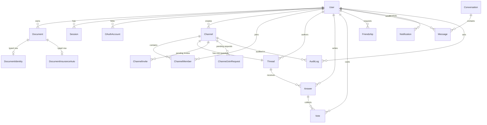

*This project has been created as part of the 42 curriculum by  *

<!-- TODO(team): replace the TODO_LOGIN_* placeholders with real 42 logins, and
     confirm `risufaj` and `amkhelif` are the right ones. The subject requires
     logins here, not first names. -->

# MesPapiers

## Description

**MesPapiers** is a paperwork assistant for people navigating French administration —
built for non-French-speaking residents and expatriates, for whom a missed renewal on a
*titre de séjour* or a passport carries the highest stakes and the language barrier sits on
top of the procedural one.

It answers two different kinds of "I don't know what to do here": the kind your own documents
can answer, and the kind only someone who has been through the procedure can.

**Key features**

- **Smart capture.** Photograph or upload a document; an AI vision model extracts its type,
  issuing authority and expiry date into strictly typed JSON — not free text.
- **Typed documents.** Each scan becomes a structured object with real database columns per
  category (an insurance contract has an insurer, a premium and an anniversary date; an
  identity document has a holder name and a number), not a bag of JSON.
- **Deadline dashboard.** Every document shows as *Valid · Expiring Soon · Expired · Action
  Required*, derived at read time so the dashboard can never contradict the alerts.
- **Dual-logic alerts.** Hard legal deadlines escalate at 90 / 60 / 30 days. Tacit contract
  renewals get an annual nudge 60 days before the anniversary — the risk there is paying above
  market rate, not losing cover, so they never display as expired.
- **AI assistant.** Ask questions about your own documents in a streaming chat, including
  "is what I'm paying for this reasonable?" — with any figure labelled explicitly as
  indicative and never as financial advice.
- **Mutual-aid community.** Topic channels (*titre de séjour*, *assurance auto*, CAF) with
  questions, voted answers, reputation, direct messaging, friends and per-channel moderation.
- **A hard boundary between the two.** Nothing from a user's private document vault ever
  reaches the community layer.

Full product specification: [`mespapiers_project_vision.md`](mespapiers_project_vision.md).
Execution plan: [`PROJECT_PLAN.md`](PROJECT_PLAN.md).

## Instructions

### Prerequisites

| Tool | Version | Notes |
|---|---|---|
| Docker + Docker Compose | v2 | The whole stack runs in containers. |
| Node.js | 22 LTS | Only needed for running the app outside Docker. |
| npm | 10+ | Ships with Node 22. One lockfile, at the repository root. |
| `mkcert` | latest | Issues the locally-trusted TLS certificate. TODO(A3) |

### Running the project

```bash
git clone <this repository>
cd ft_transcendence

cp .env.example .env        # then edit .env and set real values
docker compose up           # TODO(A2): currently starts PostgreSQL only
```

<!-- TODO(A2/A3): once nginx + web + realtime + worker are in the compose file,
     state the single command and the URL here, plus the /etc/hosts line and the
     `mkcert -install` step (R11). The subject requires a single-command
     containerised deployment. -->

### Local development without Docker

```bash
npm install
npm run dev          # http://localhost:3000
npm run typecheck    # run `npm run build` first — see the note below
npm run lint
```

> **CI ordering gotcha.** Next 16 generates route types (`LayoutProps`, `PageProps`) into
> `.next/types` during `next build`. Running `tsc --noEmit` on a clean checkout therefore
> fails before a build has happened. In CI, `next build` must come **before** the typecheck
> step.

## Team Information

<!-- TODO(team): confirm before the first evaluation. Roles are taken from
     subject_requirements.md §4. -->

| Member | 42 login | Role(s) | Responsibilities |
|---|---|---|---|
| Adrien | TODO | Product Owner · Developer | Product vision and backlog, prioritisation, validation of completed work. Infrastructure, CI, AI extraction and the assistant. |
| Rasiol | risufaj | Project Manager · Developer | Project plan, progress and risk tracking, meetings and team communication. Authentication, security and permissions. |
| Alexandre | TODO | Developer | Real-time and WebSockets, messaging, notifications, i18n, UI shell. |
| Amir | amkhelif | Technical Lead · Developer | Technical architecture and stack decisions, code review and best practices. Database, storage, community data layer, GDPR. |

## Project Management

<!-- TODO(team): fill in with what you actually do, not with what sounds good.
     Evaluators ask how work was divided and how you communicated. -->

- **Work organisation:** one owner per directory, tasks broken down in `PROJECT_PLAN.md` §7,
  each sized for roughly one developer-day with an explicit acceptance check.
- **Ceremonies:** daily 15-minute standup · Monday planning · Wednesday risk check ·
  **Friday integration**, which is a milestone gate rather than a status update.
- **Tools:** TODO (GitHub Issues / Projects / Trello?)
- **Communication:** TODO (Discord / Slack?)
- **Code review:** no direct pushes to `main`; every change goes through a pull request with
  at least one approving review.

## Technical Stack

| Layer | Choice | Why |
|---|---|---|
| Language | TypeScript everywhere | One language across the web app, the WebSocket process and the scan process; types shared by plain import. |
| Frontend | Next.js 16 (App Router, React 19) | Server Components and Server Actions put UI and HTTP backend in one codebase, which is what the "framework for frontend and backend" major asks for. |
| Styling | Tailwind CSS 4 | Utility-first, and its logical properties keep an RTL port cheap later. |
| Backend | Next.js Server Actions + Route Handlers, plus a dedicated Node `ws` process | Next.js has no supported WebSocket server API, so long-lived connections live in a plain Node process rather than in a custom server that would forfeit `next start`. |
| Database | PostgreSQL 17 | Relational data with real constraints. Uniqueness and transactions — not application code — are what make concurrent actions safe. |
| ORM | Prisma | Type-safe queries and versioned migrations; the generated types are shared by all three processes. |
| Real-time bus | Redis Pub/Sub | Publishing is fire-and-forget, so posting to a channel still succeeds when the realtime process is down. |
| AI | Anthropic `claude-opus-5` | Vision extraction into strict JSON, and the streaming assistant. |
| i18n | `next-intl` | FR / EN / ES, locale-prefixed routing. |
| Infrastructure | Docker Compose + NGINX | One image, three processes; NGINX terminates TLS so every browser-facing request is HTTPS. |

## Database Schema

PostgreSQL 17, accessed through Prisma 6 with the `prisma-client` generator
(output: `src/generated/prisma/`). The whole schema lives in [`prisma/schema.prisma`](prisma/schema.prisma)
and is applied by a single consolidated migration `prisma/migrations/20261019000000_init/`.
Every foreign key is declared with a real `@relation`, timestamps are stored in UTC and
`updatedAt` is set by Prisma on each write.

### Tables (grouped)

**Identity and access**

| Table | Key fields | Purpose |
|---|---|---|
| `User` | `id (cuid)`, `email` unique, `displayName`, `passwordHash?`, `globalRole (USER/ADMIN)`, `locale`, `totpEnabled`, `reputation` | A site account. `passwordHash` is Argon2id, `totpSecret` is encrypted when stored. |
| `Session` | `id (sha256 of token)`, `userId`, `expiresAt`, `twoFactorVerified` | A browser session. Only the hash of the token lives in the DB; the raw token is in the cookie. |
| `OAuthAccount` | `(provider, providerUserId)` unique, `userId` | Links a user to an external identity (Google, GitHub). |
| `AuditLog` | `actorUserId?`, `action`, `targetType`, `targetId`, `channelId?` (FK, `SetNull`) | One row per privileged action. Rows survive the deletion of their actor and channel. |

**Document vault — class-table inheritance**

The document vault uses class-table inheritance (one base row + one typed row per category).
The base `Document` holds everything shared across categories; a typed table (`DocumentIdentity`,
`DocumentInsuranceAuto`, …) adds the fields specific to its category.

Why class-table inheritance rather than one `jsonb` blob or one wide table:

- Each typed field is a real column with a real type and a `NOT NULL` where the field is
  mandatory, so an invalid document cannot land in the DB.
- Adding a new category is one Prisma enum value + one new typed table, with no change to
  rows of other categories.
- Common queries (dashboard, deadline scan) read the base table only; typed queries join one
  typed table at a time.

| Table | Key fields | Purpose |
|---|---|---|
| `Document` | `id`, `ownerId` (FK Cascade), `fileName`, `fileType`, `fileSize`, `fileData (bytes)`, `fileHash`, `category (enum)`, `extractionStatus (enum)`, `targetDate?`, `deadlineType?`, `@@unique([ownerId, fileHash])` | The shared base row. The unique index blocks the same file content from being uploaded twice by the same user. |
| `DocumentIdentity` | `documentId` unique (FK Cascade), `fullName`, `birthDate`, `documentNumber`, `expiryDate` | Fields read from an identity document. |
| `DocumentInsuranceAuto` | `documentId` unique (FK Cascade), `provider`, `policyNumber`, `vehiclePlate`, `expiryDate` | Fields read from a car-insurance document. |

**Community**

| Table | Key fields | Purpose |
|---|---|---|
| `Channel` | `id`, `title (VarChar 100)` unique insensitive, `description? (VarChar 250)`, `isPrivate`, `isClosed`, `createdBy?` (FK `SetNull`) | A topic. Title uniqueness is enforced by a `LOWER(title)` unique index. |
| `ChannelMember` | `(channelId, userId)` PK, `role (MEMBER/MODERATOR)`, `joinedAt` | Membership + per-channel role. |
| `ChannelInvite` | `(channelId, userId)` PK | An invite waiting to be accepted. |
| `ChannelJoinRequest` | `(channelId, userId)` PK | A request to join a private channel. |
| `Thread` | `id`, `channelId` unique (FK Cascade), `title (VarChar 150)`, `content (VarChar 300)`, `userId?` (FK `SetNull`) | The main question of a channel. The `@unique` on `channelId` enforces one thread per channel. |
| `Answer` | `id`, `threadId` (FK Cascade), `userId?` (FK `SetNull`), `content (VarChar 300)` | A reply inside a thread. |
| `Vote` | `(answerId, userId)` PK, `value Int` with `CHECK (value IN (-1, 1))` | A vote. The PK prevents double votes; the CHECK prevents junk values at the SQL layer, not just in app code. |
| `Friendship` | `(requesterId, receiverId)` unique, `status (PENDING/ACCEPTED/BLOCKED)` | A friend link. |
| `Conversation` | `(participant1Id, participant2Id)` unique | A private 1-to-1 chat. |
| `Message` | `id`, `conversationId` (FK Cascade), `senderId` (FK Cascade), `content Text` | A message in a conversation. |
| `Notification` | `id`, `recipientId` (FK Cascade), `type (enum)`, `content (VarChar 255)`, `isRead` | A notification for one user. |

### Enums

- `GlobalRole` — `USER`, `ADMIN`
- `ChannelRole` — `MEMBER`, `MODERATOR`
- `DocumentCategory` — `IDENTITY`, `INSURANCE_AUTO`, `OTHER`
- `DeadlineType` — `HARD`, `SOFT`, `PERIODIC`, `NONE`
- `ExtractionStatus` — `PENDING`, `NEEDS_REVIEW`, `CONFIRMED`, `FAILED`
- `FriendshipStatus` — `PENDING`, `ACCEPTED`, `BLOCKED`
- `NotificationType` — `DEADLINE`, `REPLY`, `MESSAGE`, `FRIEND_REQUEST`, `OTHER`

### Diagram



### Rules worth highlighting

- A document's **status** (`VALID / EXPIRING_SOON / EXPIRED / ACTION_REQUIRED`) is derived at
  read time from `extractionStatus`, `deadlineType` and `targetDate`. It is never stored.
- Deletion of a `User` cascades to their own data (documents, sessions, memberships, friends,
  conversations, votes, notifications, OAuth accounts). Content they wrote in channels
  (threads, answers) switches `userId` to `NULL` so the discussion stays readable.
- Deletion of a `Channel` cascades to its members, invites, join requests, threads and
  answers; audit rows survive with `channelId` set to `NULL`.

## Features List

<!-- TODO(team): fill in as features land — feature, owner, what it does.
     Keep it honest; evaluators cross-check it against the code. -->

TODO

## Modules

Target: **22 points** — 7 major (2 pts each) + 8 minor (1 pt each). The subject requires 14
and caps the bonus at +5, so at most 19 can count; the surplus is deliberate insurance against
a module failing validation, not extra credit.

<!-- TODO(team): keep this table in sync with what is actually demonstrable.
     A module that is not fully functional scores zero — see the subject. -->

| Module | Type | Pts | Owner |
|---|---|---|---|
| Framework for frontend and backend (Next.js) | Major | 2 | Adrien |
| Complete LLM system interface (streaming assistant) | Major | 2 | Adrien |
| Standard user management and authentication | Major | 2 | Rasiol |
| Advanced permissions system | Major | 2 | Rasiol |
| Real-time features using WebSockets | Major | 2 | Alexandre |
| User interaction (chat, profiles, friends) | Major | 2 | Alexandre |
| Organization system (community channels) | Major | 2 | Amir |
| Remote authentication with OAuth 2.0 | Minor | 1 | Rasiol |
| Complete 2FA system (TOTP) | Minor | 1 | Rasiol |
| Complete notification system | Minor | 1 | Alexandre |
| Multiple languages (FR / EN / ES) | Minor | 1 | Alexandre |
| Use an ORM for the database (Prisma) | Minor | 1 | Amir |
| File upload and management system | Minor | 1 | Amir |
| Image recognition and tagging (document OCR) | Minor | 1 | Adrien |
| GDPR compliance features | Minor | 1 | Amir |
| **Total** | | **22** | |

Justification for each module choice, and how each was implemented, is in
[`PROJECT_PLAN.md`](PROJECT_PLAN.md) §6. Notably, the **RAG** major was considered and
deliberately **not** claimed: at personal scale there is nothing to retrieve, and a retrieval
step that does not retrieve scores zero.

## Individual Contributions

<!-- TODO(team): detailed per-person breakdown, plus challenges faced and how
     they were overcome. Required by the subject and read closely. -->

TODO

## Resources

**Documentation**

- [Next.js App Router](https://nextjs.org/docs/app) — note that Next 16 differs from most
  tutorials and from most model training data; the version-accurate guides ship in
  `node_modules/next/dist/docs/`.
- [Prisma](https://www.prisma.io/docs) — schema, relations and migrations.
- [The Copenhagen Book](https://thecopenhagenbook.com) and the
  [Auth Book](https://auth.pilcrowonpaper.com) — the specification followed for hand-rolled
  sessions, OAuth 2.0 with PKCE and TOTP. Lucia was deprecated in March 2025 and Arctic in
  July 2026; both survive as reference implementations rather than packages.
- [OWASP Top 10](https://owasp.org/www-project-top-ten/) — the checklist used for the security
  review.
- [WCAG 2.1](https://www.w3.org/TR/WCAG21/) — accessibility targets.
- [MDN: Server-Sent Events](https://developer.mozilla.org/en-US/docs/Web/API/Server-sent_events)
  and [`ws`](https://github.com/websockets/ws) — the two real-time transports used.

**Use of AI**

<!-- TODO(team): the subject requires this section to state which tasks and which
     parts of the project used AI. Be specific and honest — you are examined on
     your ability to explain any code you ship, whoever wrote it. -->

- **Product and planning documents.** The vision and the implementation plan were drafted with
  AI assistance and then reviewed, challenged and edited by the team.
- **TODO:** record here, as you go, which parts of the codebase were written with AI
  assistance and which were not.

